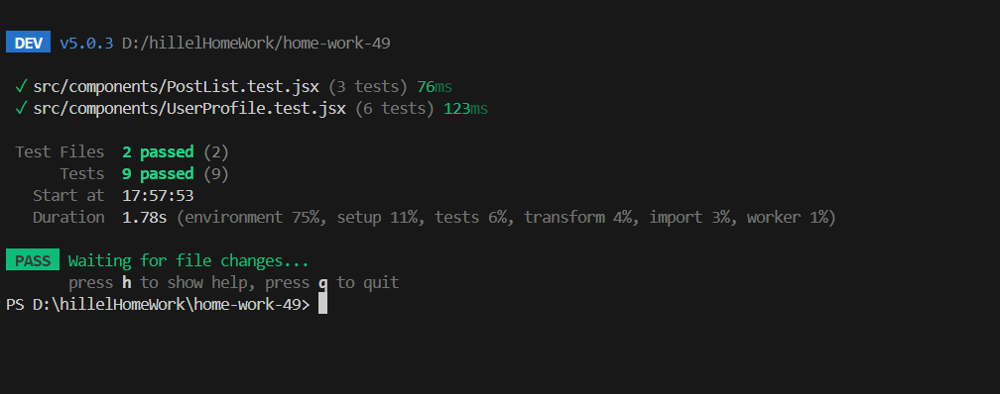

# Домашнє завдання 49

## Опис проекту
Цей проект є React-додатком, що демонструє роботу з асинхронними запитами до API та їх тестування за допомогою Vitest і React Testing Library. Створено компонент `UserProfile`, який виконує GET-запит для отримання даних користувача і обробляє стани завантаження, успіху та помилки.

## Інструкції зі встановлення та запуску
1. Клонуйте репозиторій.
2. Встановіть залежності:
   ```bash
   npm install
   ```
3. Запустіть проект у режимі розробки:
   ```bash
   npm run dev
   ```
4. Для запуску тестів використовуйте команду:
   ```bash
   npm test
   ```

## 🚀 Live Demo
Проєкт розгорнуто на Vercel. Ви можете переглянути його за цим посиланням:
**[https://home-work-49-sand.vercel.app](https://home-work-49-sand.vercel.app)**

## Скріншот з успішним проходженням усіх тестів
Нижче наведено скріншот результатів виконання `npm test`:


